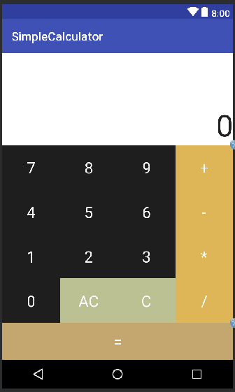

# Simple Calculator

An Android calculator app for the four basic operations. The display is a custom view that extends `AppCompatEditText` and keeps the calculation state inside it, and the operator buttons extend `AppCompatButton` so that each button carries its own operation.

<p>
  
</p>


## How to use

Open `source/` in Android Studio and build it. The project uses Android Gradle plugin 3.0.1, Gradle 4.1, and `compileSdkVersion 26`, with a `minSdkVersion` of 22 (Android 5.1).

| Button | Action |
|---|---|
| 0 to 9 | Appends the digit to the number on the display |
| `+` `-` `*` `/` | Moves the current number to the left operand and clears the display |
| `=` | Shows the result on the display |
| AC | Resets to 0 |
| C | Deletes the last digit |

One operation is calculated at a time. Pressing another operator after an operator and before `=` shows the toast "'=' 버튼을 눌러 연산해주세요!" (press '=' to calculate). Dividing by 0 shows "0으로 나눌 수 없습니다!" (cannot divide by 0) and leaves the display as it is. Numbers are shown with the thousands separator of the device locale.


## How it works

**The operation lives in the button.** `BtnOperator` is a button that holds one `OnCalculateListener` interface. When `MainActivity` starts, it reads the label of each of the 4 operator buttons and attaches the matching listener once. After that, the calculator only calls `calculate` on the registered button without checking which one was pressed.

```java
public Number calculate(Number number1, Number number2)
{
    if (calculateListener != null) {
        return calculateListener.onCalculate(number1, number2);
    }
    else {
        return Double.NaN;
    }
}
```

**The display holds the calculation state.** `EdtCalculator` keeps the left operand and the pressed operator button as fields. Pressing an operator moves the current number to the left operand and remembers that button, and pressing `=` hands both numbers to the remembered button. The display is reset to the result only when the result is not `NaN`, so a failure such as dividing by 0 leaves the screen unchanged.

**The display is formatted with `NumberFormat`.** Every time a digit is appended or deleted, the text is turned back into a plain number string, edited, and shown again through `NumberFormat.format`. An empty string reads as 0.

**The keypad is laid out by ratio.** Two horizontal guidelines (`0.3` and `0.88`) in the `ConstraintLayout` give the top 30% to the display, the middle to the digits and operators, and the bottom 12% to the `=` button.


## Files

| Path | Content |
|---|---|
| `source/app/src/main/java/com/jungu/simplecalculator/MainActivity.java` | Button wiring and operation listener registration |
| `source/app/src/main/java/com/jungu/simplecalculator/EdtCalculator.java` | Display and calculation state |
| `source/app/src/main/java/com/jungu/simplecalculator/BtnOperator.java` | Operator button that carries its operation |
| `source/app/src/main/res/layout/activity_main.xml` | Screen layout |
| `source/app/src/main/res/values/strings.xml` | App name and toast messages |
| `docs/screenshots/` | Screenshots |


## License

zlib. See [LICENSE](LICENSE).
